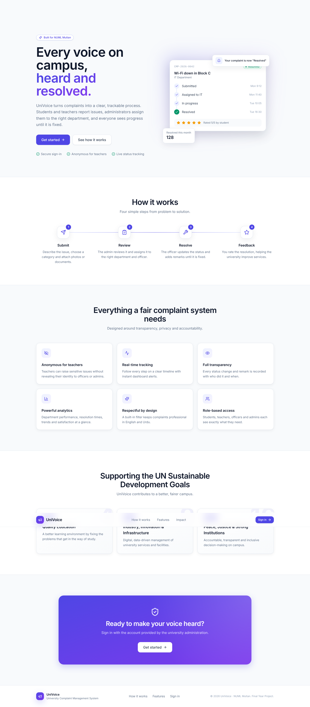
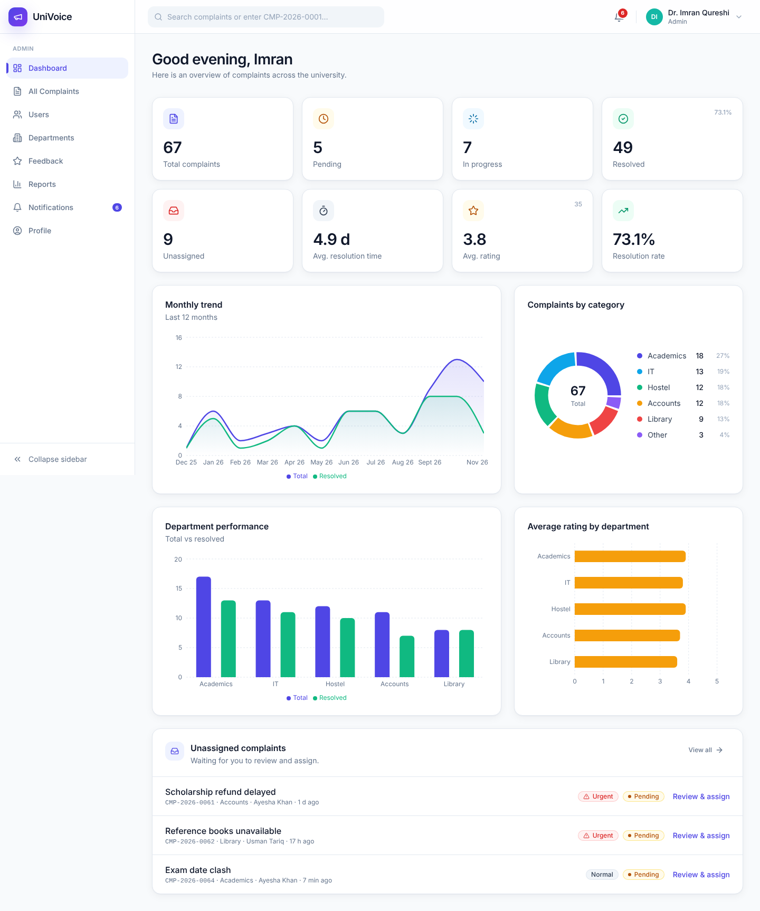
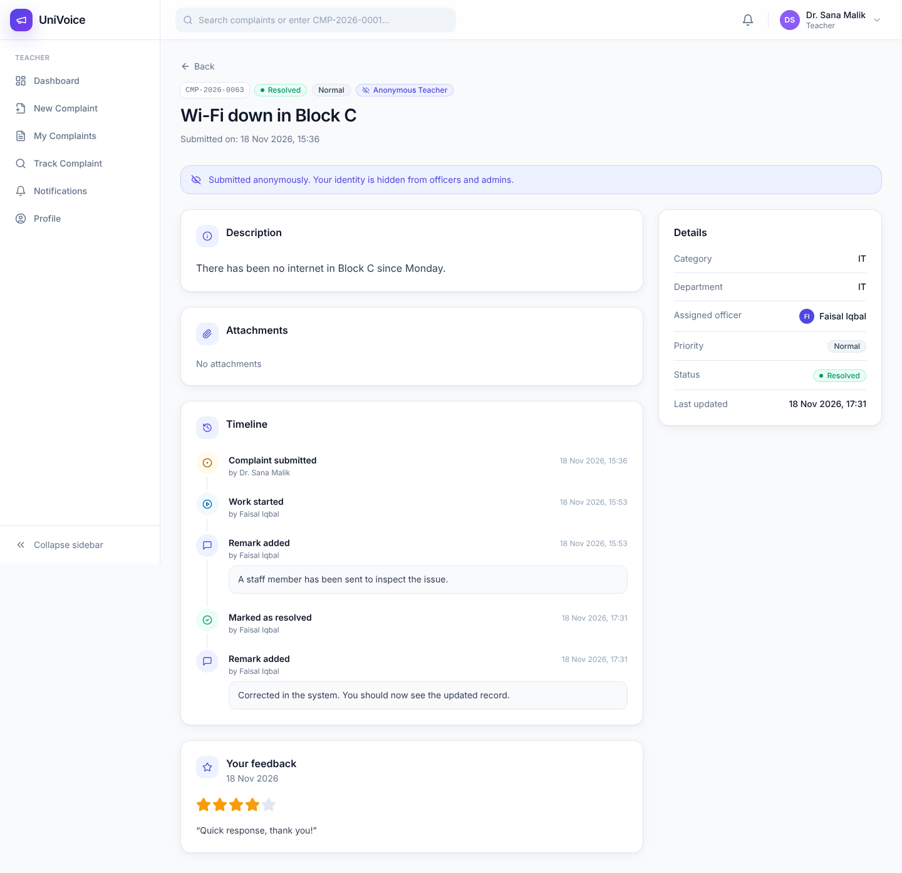
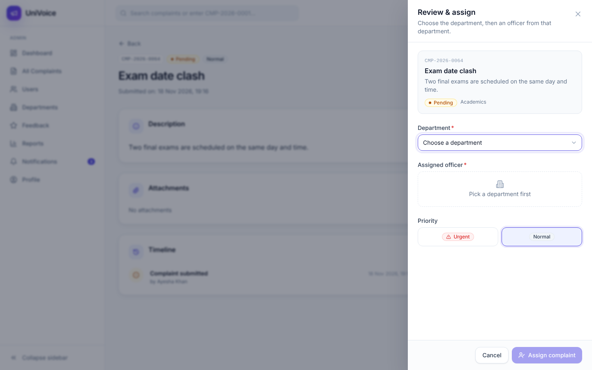
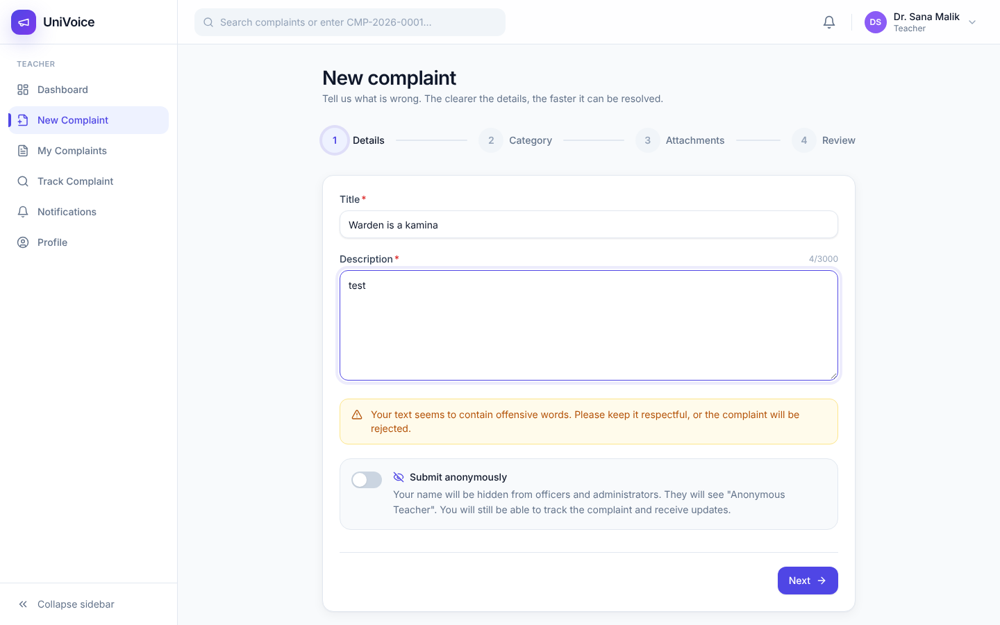
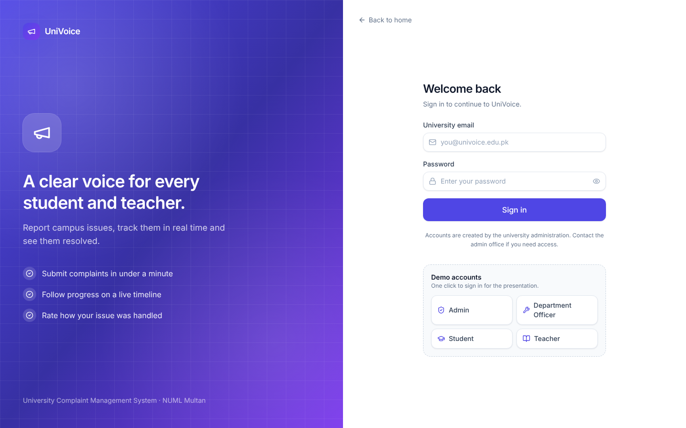
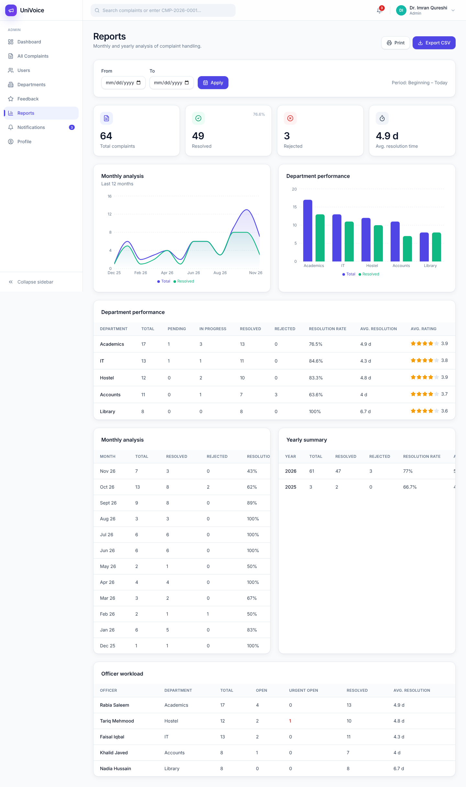
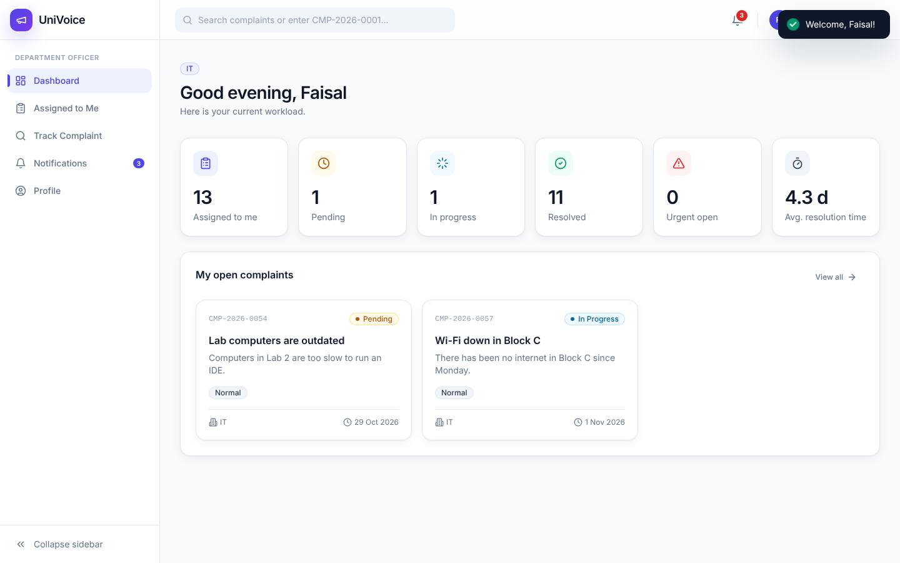
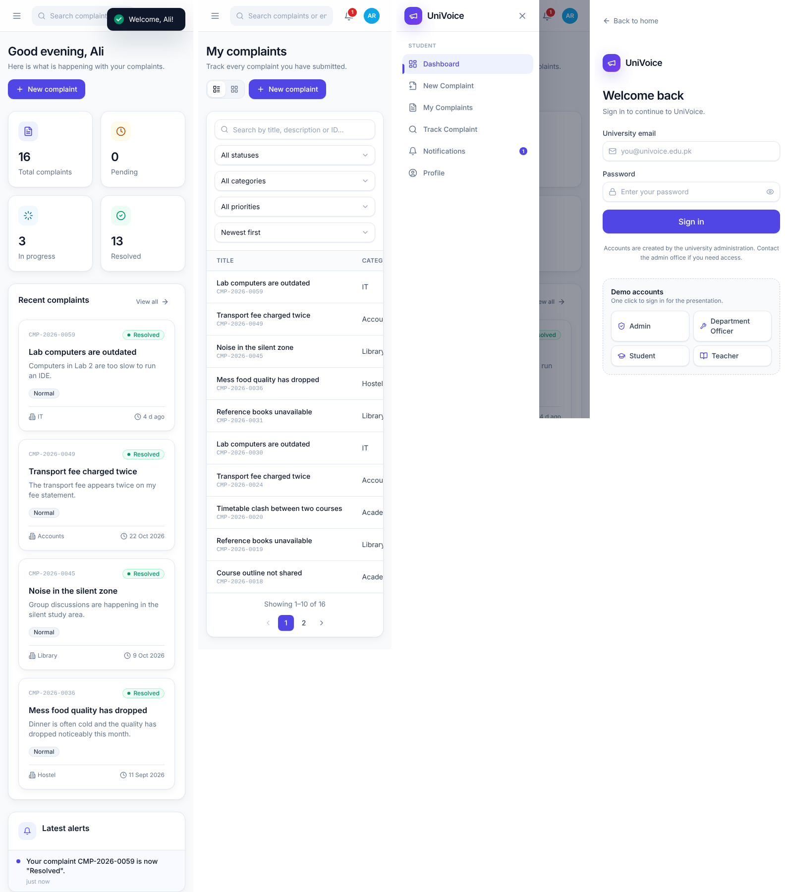

# UniVoice – University Complaint Management System

Final Year Project · **NUML Multan** · Built with the **MERN** stack (MongoDB, Express, React, Node.js).

UniVoice turns campus complaints into a clear, trackable process. Students and teachers submit complaints, the admin assigns each one to the right department and officer, the officer works on it and updates its status, and the complainant follows every step on a live timeline and rates the result at the end.



---

## Contents
1. [Features](#features)
2. [Screenshots](#screenshots)
3. [Install and run](#install-and-run)
4. [Demo logins](#demo-logins)
5. [How to change colors and text](#how-to-change-colors-and-text)
6. [Folder map](#folder-map)
7. [Tests](#tests)
8. [More documents](#more-documents)

---

## Features

**For everyone**
- Secure sign-in (the login is kept in a protected browser cookie). There is no public sign-up: the admin creates every account.
- Dashboard alerts (a bell with an unread count) that refresh every 15 seconds, with a pop-up message when something changes. There are no emails or SMS.
- Track any complaint by its ID, e.g. `CMP-2026-0012`.
- Profile page and change password.
- Works on phones, tablets and desktops.

**Students and teachers**
- A 4-step complaint form: Details → Category → Attachments → Review.
- Up to 3 attachments (JPG, PNG or PDF, max 5 MB each), with drag & drop and previews.
- **Teachers only:** a "Submit anonymously" option. Officers and the admin then see "Anonymous Teacher" everywhere.
- Live warning about offensive words while typing (English, Roman Urdu and Urdu).
- "My Complaints" in a table or card view, with filters and search.
- A complaint page with a vertical timeline, remarks, attachments and a star-rating feedback form once the complaint is resolved.

**Admin**
- A dashboard with key numbers and charts (by category, monthly trend, department performance, average rating) and a list of unassigned complaints.
- All complaints, with filters, search, sorting and pages.
- **Review & assign:** choose a department, then an officer from that department, then a priority (urgent or normal). Every assignment is made by hand; nothing is routed automatically.
- Reject a complaint with a reason.
- Manage users (create, edit, activate/deactivate, reset password) and departments.
- Feedback list.
- Reports: monthly and yearly analysis, department performance, officer workload, a date range, **CSV export** and a print-friendly view.

**Department officer**
- A dashboard with their own workload.
- Sees only the complaints assigned to them.
- Moves a complaint forward (Pending → In Progress → Resolved) and adds remarks.

---

## Screenshots

| | |
|---|---|
| **Admin dashboard**<br> | **Complaint detail with timeline**<br> |
| **Review & assign drawer**<br> | **New complaint with live profanity warning**<br> |
| **Login with demo buttons**<br> | **Reports**<br> |
| **Officer dashboard**<br> | **Mobile views**<br> |

The page `/ui-preview` shows every design component in one place ([screenshot](docs/screenshots/03-uipreview.png)).

---

## Install and run

### 1. Install these once
- **Node.js** version 18 or newer: https://nodejs.org
- **MongoDB**: either install it on your computer (https://www.mongodb.com/try/download/community) or create a free cloud database at https://www.mongodb.com/atlas

### 2. Install the project
Open a terminal in the project folder and run:

```bash
npm run install-all
```

### 3. Add your settings
Make a copy of each example settings file and name it `.env`:

- `server/.env.example` → `server/.env`
- `client/.env.example` → `client/.env`

Open `server/.env` and set:
- `MONGO_URI`: your database address (the example works with a local MongoDB).
- `JWT_SECRET`: any long random text.

### 4. Fill the database with demo data
```bash
npm run seed
```
⚠️ This **deletes all existing data**. It then creates 5 departments, 11 accounts and 64 realistic complaints spread over the last 12 months, with feedback and notifications. The logins are printed in the terminal.

### 5. Start the app
```bash
npm run dev
```
- Website: http://localhost:5173
- Server: http://localhost:5000 (health check: http://localhost:5000/api/health)

Press `Ctrl + C` in the terminal to stop.

---

## Demo logins

Every demo account uses the password **`Password@123`**. The login page also has one-click demo buttons. To hide them, set `VITE_SHOW_DEMO=false` in `client/.env`.

| Role | Email |
|------|-------|
| Admin | `admin@univoice.edu.pk` |
| Officer – Hostel | `hostel.officer@univoice.edu.pk` |
| Officer – Library | `library.officer@univoice.edu.pk` |
| Officer – Accounts | `accounts.officer@univoice.edu.pk` |
| Officer – IT | `it.officer@univoice.edu.pk` |
| Officer – Academics | `academics.officer@univoice.edu.pk` |
| Student | `ali.student@univoice.edu.pk` |
| Student | `ayesha.student@univoice.edu.pk` |
| Student | `usman.student@univoice.edu.pk` |
| Teacher | `sana.teacher@univoice.edu.pk` |
| Teacher | `bilal.teacher@univoice.edu.pk` |

---

## How to change colors and text

You never need to edit a page to change how it looks or what it says. Everything is collected in a few settings files:

| I want to change… | Edit this file |
|---|---|
| **Colors**, font, corner roundness, shadows, chart colors | `client/src/config/theme.js` |
| **Any text on the website** (titles, buttons, messages, landing page) | `client/src/config/strings.js` |
| Menus, roles, statuses, categories, upload limits, demo buttons | `client/src/config/constants.js` |
| The same lists on the server (keep them matching the file above) | `server/config/constants.js` |
| Messages the server sends back (errors, notification texts, CSV headings) | `server/config/messages.js` |
| Blocked offensive words | `server/config/badWords.js` |
| Demo data (names, complaint texts) | `server/seed/data.js` |
| Database address, secret key, ports | `server/.env` and `client/.env` |

**Example: change the main color from indigo to teal.** Open `client/src/config/theme.js` and change the `primary` color codes:
```js
primary: {
  DEFAULT: '#0D9488',   // main color
  hover:   '#0F766E',   // a bit darker, used on mouse-over
  dark:    '#115E59',
  soft:    '#F0FDFA',   // very light, used for backgrounds
  muted:   '#99F6E4',
},
```

**Example: change the landing page headline.** Open `client/src/config/strings.js`, find `landing:`, and edit the text inside the quotes:
```js
title: 'Every voice on campus,',
titleHighlight: 'heard and resolved.',
```

Tips:
- Only change the text **inside the quotes** `'…'`, and keep the commas at the end of each line.
- Save the file; the website updates by itself while `npm run dev` is running.

---

## Folder map

```
OCMS/
├── package.json        ← "npm run dev", "npm run install-all", "npm run seed"
├── README.md           ← this guide
├── docs/
│   ├── API.md          ← every server endpoint with Postman examples
│   ├── TEST_CASES.md   ← test case table for the thesis (Chapter 5)
│   └── screenshots/
│
├── client/             ← THE WEBSITE (React + Vite + Tailwind)
│   └── src/
│       ├── config/         ← theme.js (colors), strings.js (text), constants.js (lists, menus)
│       ├── components/
│       │   ├── ui/         ← reusable building blocks: Button, Input, Card, Modal, Table…
│       │   ├── layout/     ← sidebar, top bar, notification bell, user menu
│       │   ├── complaints/ ← complaint table, timeline, assign drawer, feedback form…
│       │   └── charts/     ← dashboard charts
│       ├── pages/
│       │   ├── public/     ← landing, login, 404, unauthorized, UI preview
│       │   ├── shared/     ← complaint list & detail, track, notifications, profile
│       │   ├── user/       ← student/teacher dashboard and new complaint form
│       │   ├── officer/    ← officer dashboard
│       │   └── admin/      ← admin dashboard, users, departments, feedback, reports
│       ├── context/        ← who is logged in, notification polling
│       ├── services/       ← the one connection to the server (api.js) + all calls
│       ├── hooks/ utils/   ← small helpers
│       └── routes/         ← page addresses and who can open them
│
└── server/             ← THE BACKEND (Node + Express + MongoDB)
    ├── config/         ← constants, messages, bad words, database connection
    ├── models/         ← database tables: User, Department, Complaint, Feedback, Notification
    ├── controllers/    ← what each endpoint does
    ├── routes/         ← endpoint addresses
    ├── middleware/     ← login check, role check, validation, uploads, errors
    ├── services/       ← queries, analytics, CSV report, notifications
    ├── validators/     ← input rules
    ├── utils/          ← small helpers (profanity check, tokens…)
    ├── seed/           ← demo data script
    ├── tests/          ← automated tests
    └── uploads/        ← complaint attachments are saved here
```

---

## Tests

```bash
cd server
npm test
```
This runs 64 automated tests covering login, complaint submission (including the profanity and anonymity rules), assignment, status updates, feedback and notifications. They use a temporary database, so your data is safe. To regenerate the thesis table in `docs/TEST_CASES.md`, run `npm run test:report`.

---

## More documents
- [docs/API.md](docs/API.md): every endpoint with example requests for Postman or Thunder Client.
- [docs/TEST_CASES.md](docs/TEST_CASES.md): test cases with ID, description, input, expected result, actual result and outcome.

## User roles
- **Admin**: manages users and departments, assigns and rejects complaints, sees analytics and reports.
- **Department officer**: handles the complaints assigned to them.
- **Student**: submits and tracks complaints.
- **Teacher**: submits (optionally anonymously) and tracks complaints.
